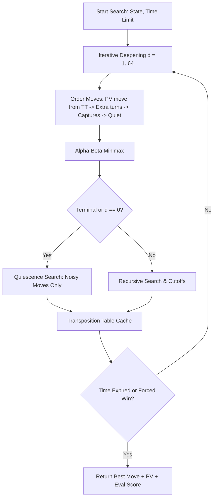

# Turkish Mangala (Mancala)

<p align="center">
  
</p>

<p align="center">
  <strong>An authentic Turkish Mangala engine with a tournament-grade AI, modern web interface, CLI, and desktop GUI.</strong>
</p>

<p align="center">
  <a href="https://github.com/mammadow/mangala/actions"></a>
  <a href="https://pypi.org/project/mangala-game/"></a>
  <a href="https://pypi.org/project/mangala-game/"></a>
  <a href="LICENSE"></a>
  <a href="https://github.com/astral-sh/ruff"></a>
</p>

---

## ✨ Features

- **Pure, Tested Game Engine**: Zero runtime dependencies. Functional, immutable board representations verified by property-based fuzzing and 100% stone conservation tests.
- **Tournament-Grade AI**:
  - Alpha-Beta search with iterative deepening and anytime time-budget management.
  - Symmetrical root evaluation handling Turkish Mangala extra-turn branches without negamax sign inversions.
  - 64-bit Transposition Table (TT) caching exact values, lower bounds, and upper bounds with Principal Variation (PV) ordering.
  - Quiescence search extending tactical captures and extra turns up to 4 plies.
  - Endgame exact solver for terminal positions with $\le 12$ stones.
  - Thread-safe design for concurrent API calls and background hint processing.
- **Three Front-Ends**:
  - 🌐 **Modern Web GUI**: Single-file responsive interface with board flip (180° rotation), felt/wood aesthetic, animated stone sowing, move history log, undo/redo, and live AI suggestions.
  - 💻 **Terminal CLI**: Terminal board with ANSI/ASCII support, step-by-step turns, and difficulty presets.
  - 🎮 **Pygame Desktop GUI**: Legacy arcade-style desktop window with stone physics and animation banners.

---

## 🚀 Quick Start

### Installation

Install via `pip`:

```bash
# Standard installation (Web GUI + CLI, zero external dependencies)
pip install mangala-game

# Optional Pygame desktop GUI
pip install "mangala-game[gui]"
```

Or clone and run locally:

```bash
git clone https://github.com/mammadow/mangala.git
cd mangala
python -m venv .venv
source .venv/bin/activate  # On Windows: .venv\Scripts\activate
pip install -e .
```

### Running

```bash
# Launch modern Web GUI (opens http://localhost:8000 automatically)
mangala

# Launch interactive CLI in your terminal
mangala-cli

# Launch Pygame GUI (requires mangala-game[gui])
mangala-gui
```

*(You can also run directly with `python server.py`, `python main.py`, or `python gui.py`)*

---

## 📜 Turkish Mangala Rules

Turkish Mangala is played on a board with **12 pits** (6 per player) and **2 treasuries** (*Hazine*).

```text
               Player 2 Pits (top row)
           12   11   10    9    8    7
  P2 [ 0]  [ 4]  [ 4]  [ 4]  [ 4]  [ 4]  [ 4]  [ 0] P1
           [ 4]  [ 4]  [ 4]  [ 4]  [ 4]  [ 4]
            0    1    2    3    4    5
               Player 1 Pits (bottom row)
```

1. **Sowing**: Choose an owned pit.
   - If it has $> 1$ stone: leave 1 stone behind, and sow the remainder counterclockwise.
   - If it has exactly $1$ stone: pick it up and sow it into the next counterclockwise pit.
   - The opponent's treasury is **always skipped**.
2. **Extra Turn**: If the last sown stone lands in your own treasury, you play again immediately.
3. **Regular Capture**: If the last stone lands in an opponent's pit and makes that pit's total count **even**, you capture all stones from that pit into your treasury.
4. **Empty-Hole Capture**: If the last stone lands in your own pit that was previously empty (now has 1 stone), and the opposite opponent pit (`12 - i`) has stones, you capture your stone **plus** all stones in the opposite pit!
5. **Endgame Sweep**: When either player's side is completely empty, the player whose side emptied captures all remaining stones on the board. The player with the most stones in their treasury wins!

*Detailed rule breakdowns and official variations are documented in [docs/rules.md](docs/rules.md).*

---

## 🧠 AI Architecture

The search engine is implemented in [`src/mangala/ai.py`](src/mangala/ai.py):



### Search Features
- **Thread Safety**: Each search maintains its own `Searcher` instance, allowing multi-threaded HTTP requests and real-time interactive hints without race conditions.
- **Transposition Table**: Stores position hash tuples with flags (`EXACT`, `LOWER_BOUND`, `UPPER_BOUND`) to achieve massive pruning efficiency.
- **Difficulty Presets**:
  - `easy`: Depth 2 search.
  - `medium`: Depth 5 search.
  - `hard`: 1.0 second iterative deepening.
  - `expert`: 2.5 seconds tournament iterative deepening.

---

## 📂 Project Structure

```text
mangala/
├── .github/workflows/ci.yml       # GitHub Actions Multi-OS CI
├── docs/
│   ├── rules.md                   # Complete rules specification
│   ├── architecture.md            # System design & algorithm details
│   └── devlog.md                  # Development log & fix history
├── src/mangala/
│   ├── __init__.py                # Package version & top-level exports
│   ├── __main__.py                # python -m mangala entrypoint
│   ├── engine.py                  # Pure rules engine & immutable GameState
│   ├── ai.py                      # Thread-safe Minimax / TT / Quiescence
│   ├── server.py                  # Hardened stdlib HTTP server & JSON API
│   ├── cli.py                     # Terminal interface
│   ├── board.py                   # ASCII board renderer
│   ├── gui_pygame.py              # Pygame desktop UI
│   └── web/index.html             # Single-file modern web UI
├── tests/
│   ├── test_engine.py             # Engine unit tests & rule verification
│   ├── test_ai.py                 # AI search, pruning, and thread-safety tests
│   ├── test_server.py             # REST API & security hardening tests
│   └── test_properties.py         # Hypothesis fuzzing & conservation tests
├── tools/
│   └── selfplay.py                # AI benchmarking & self-play arena
├── pyproject.toml                 # PEP 621 package & tool configurations
├── LICENSE                        # MIT License
└── README.md
```

---

## 🧪 Testing & Quality

Run the test suite:

```bash
# Run all tests with coverage
pytest --cov=mangala tests/

# Run property-based hypothesis tests
pytest tests/test_properties.py

# Lint and type check
ruff check .
mypy src/mangala/
```

---

## 🤝 Contributing

Contributions are welcome! Please check out [CONTRIBUTING.md](CONTRIBUTING.md) for details on code style, testing requirements, and issue submission.

---

## 📄 License

This project is licensed under the [MIT License](LICENSE).
