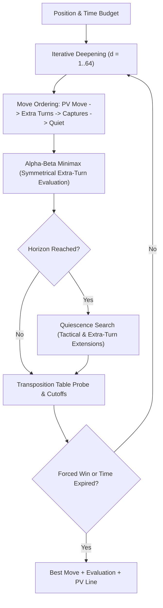

<div align="center">

# 🏺 Turkish Mangala (Mancala)

[](https://mammadow.github.io/mangala/)

### Authentic Game Engine • Tournament AI • Responsive Web • Terminal CLI • Desktop Arcade

[](https://github.com/mammadow/mangala/actions/workflows/ci.yml)
[](https://pypi.org/project/mangala-game/)
[](https://pypi.org/project/mangala-game/)
[](https://github.com/mammadow/mangala)
[](https://github.com/mammadow/mangala)
[](https://mammadow.github.io/mangala/)
[](https://mammadow.github.io/mangala/)
[](LICENSE)
[](https://github.com/astral-sh/ruff)

<p align="center">
  <a href="https://mammadow.github.io/mangala/"><strong>🎮 Play Live in Browser</strong></a> •
  <a href="#-quick-start"><strong>🚀 Quick Start</strong></a> •
  <a href="#-tournament-features"><strong>✨ Features</strong></a> •
  <a href="#-three-ways-to-play"><strong>🕹️ Interfaces</strong></a> •
  <a href="#-turkish-mangala-rules"><strong>📜 Rules</strong></a> •
  <a href="#-ai-architecture"><strong>🧠 AI Engine</strong></a> •
  <a href="docs/MUI_SPEC.md"><strong>🔌 MUI Protocol</strong></a> •
  <a href="docs/MPGN_SPEC.md"><strong>📝 MPGN Notation</strong></a>
</p>

</div>

---

## 🌟 Highlights & Tournament Feature Matrix

| Capability | Specification |
| :--- | :--- |
| **Pure Standard Library Engine** | Zero runtime dependencies (`dependencies = []`). Immutable `GameState` verified by property-based Hypothesis fuzzing. |
| **Tournament-Grade AI** | PVS with null-window scouting, 2-tier killer heuristic, history heuristic table, 25-stone mathematical win threshold, 180° opening book involution, and depth 64 endgame solver. |
| **Real-Time Evaluation Bar** | Live win probability and stone evaluation gauge rendered continuously during matches. |
| **Visual Board Themes** | 4 luxury hand-crafted visual palettes: *Classic Walnut*, *Carrara Marble*, *Obsidian Night*, and *Anatolian Terracotta*. |
| **Tactical Puzzle Trainer** | 16 authentic curated Turkish Mangala tactical scenarios across 3 tiers (*Apprentice*, *Master*, *Grandmaster*) with multi-move combination handling, live validation, and progress tracking. |
| **Interactive Playable Tutorial** | 7-step guided onboarding walkthrough directly on the game board covering 100% of authentic Turkish rules in one continuous session with pulsating pit highlights. |
| **Competitive Clocks & Timers** | Tournament time controls: *Casual (Unlimited)*, *Bullet (1m+1s)*, *Blitz (3m+2s)*, and *Rapid (5m+3s)* with timeout flag-fall handling. |
| **Post-Game Review & Accuracy** | Move-by-move evaluation analysis, centipawn loss calculation, and move classifications (*Best*, *Good*, *Inaccuracy*, *Mistake*, *Blunder*). |
| **P2P Multiplayer & Room Codes** | Play with friends across local networks or the web using fast 4-letter room codes or serverless WebRTC data channels. |
| **Progressive Web App (PWA)** | Installable desktop and mobile app with full cache-first offline service worker support. |
| **MUI Tournament Protocol** | Universal text-based engine interface (`mangala --mui` / `--uci`) for connecting to tournament managers and bot arenas. |
| **MPGN Match Notation** | Standardized *Mancala Portable Game Notation* (`.mpgn`) with 1-click clipboard copy, file export, and move sequence replay. |

---

## 🚀 Quick Start

### Installation

#### Option 1: Official PyPI Package (Recommended)

Install directly from [PyPI](https://pypi.org/project/mangala-game/):

```bash
# Standard installation (Modern Web GUI + CLI + AI Engine, zero external dependencies)
pip install mangala-game

# With optional Pygame desktop arcade GUI (works on Python 3.10–3.14)
pip install "mangala-game[gui]"
```

#### Option 2: Direct from GitHub

```bash
pip install git+https://github.com/mammadow/mangala.git
```

#### Option 3: Clone & Develop from Source

```bash
git clone https://github.com/mammadow/mangala.git
cd mangala
python -m venv .venv
source .venv/bin/activate  # Windows: .venv\Scripts\activate
pip install -e ".[dev,gui]"
```

---

## 🕹️ Three Ways to Play

### 1. 🌐 Modern Web GUI
Launch the local web server (automatically opens in your browser at `http://localhost:8000`):

```bash
mangala
# or: python -m mangala.server
```

- **Features**: Animated stone sowing, difficulty pills (`Easy`, `Medium`, `Hard`, `Expert`), speed toggle (`⚡ 1x`, `2x`, `Instant`), 180° board rotation (`F` key), keyboard pit sowing (keys `1`–`6`), live move history, undo/redo, and interactive AI coach hints.
- **Offline / Static**: You can also open [`src/mangala/web/index.html`](src/mangala/web/index.html) directly in any modern browser without Python running!

### 2. 💻 Terminal CLI
Play an authentic text-based game directly inside your terminal with active player indicators and ANSI color highlights:

```bash
mangala-cli
# or: python -m mangala.cli
```

- **Modes**:
  - `1` : Human vs Human (hotseat)
  - `2` : Human vs AI (choose your side and difficulty)
  - `3` : AI vs AI (spectate the minimax engine analyzing in real time)

### 3. 🎮 Pygame Desktop GUI
For an arcade-style experience with desktop window physics, stone drop sounds, and capture banners:

```bash
mangala-gui
# or: python -m mangala.gui_pygame
```

---

## 📜 Turkish Mangala Rules

Turkish Mangala is played on a board with **12 pits** (6 per player) and **2 treasuries** (*Hazine*). Total of **48 stones** (4 in each pit initially).

```text
               Player 2 Pits (top row, counterclockwise)
           12   11   10    9    8    7
  P2 [ 0]  [ 4]  [ 4]  [ 4]  [ 4]  [ 4]  [ 4]  [ 0] P1
           [ 4]  [ 4]  [ 4]  [ 4]  [ 4]  [ 4]
            0    1    2    3    4    5
               Player 1 Pits (bottom row, counterclockwise)
```

### The 4 Core Rules

1. **🌰 Sowing**: Pick up all stones from one of your pits:
   - If the pit has **$> 1$ stone**: Leave **1 stone behind** in the origin pit, then sow the remaining stones counterclockwise one-by-one into consecutive pits and your own treasury.
   - If the pit has **exactly $1$ stone**: Lift it and place it into the **next pit** to the right (the origin pit becomes empty).
   - **Opponent's Treasury is always skipped**.
2. **⚡ Extra Turn**: If the last sown stone lands in your own treasury (*Hazine*), you retain your turn and play again immediately.
3. **🎯 Even Capture**: If the last sown stone lands in an opponent's pit and makes that pit's total count **even** ($2, 4, 6, \dots$), you capture **all stones from that pit** and deposit them into your treasury.
4. **🔄 Empty-Hole Capture**: If the last sown stone lands in one of your own pits that was previously empty (now has 1 stone), and the opposite opponent pit (`12 - i`) contains stones, you capture your stone **plus all stones from the opposite pit**.
5. **🏁 Endgame Sweep**: When either player's 6 pits are completely emptied, the game ends immediately. The player whose side emptied captures **all remaining stones on the opponent's side**. The player with the highest score wins!

> [!TIP]
> Comprehensive rule variations, official tournament rules, and tactical strategy guides are available in [docs/rules.md](docs/rules.md).

---

## 🧠 AI Architecture

The minimax search engine is located in [`src/mangala/ai.py`](src/mangala/ai.py).



### Key AI Features

- **Symmetrical Root Alpha-Beta**: Turkish Mangala grants extra turns on treasury finishes, breaking standard negamax sign inversions. The engine uses explicit alternating min/max routines to evaluate branch chains correctly.
- **Principal Variation (PV) Ordering**: Move ordering checks the transposition table first, evaluating high-probability cutoffs first to maximize alpha-beta pruning.
- **Quiescence Search**: Extends search horizons up to 4 extra plies for tactical captures and extra turns to eliminate horizon effect blunders.
- **Endgame Exact Solver**: Automatically transitions to a full retrograde solver whenever $\le 12$ stones remain on the board, calculating forced wins up to depth 64.
- **Anytime Budgeting**: Iterative deepening with clock checks every 128 nodes ensures strict adherence to time constraints.

### Difficulty Presets

| Preset | Search Method | Typical Depth | Target Audience |
| :--- | :--- | :--- | :--- |
| **`easy`** | Fixed-depth minimax | Depth 2 | Beginners & learning the rules |
| **`medium`** | Fixed-depth with Quiescence | Depth 5 | Casual play |
| **`hard`** | Iterative Deepening | ~8–12 plies (1.0s budget) | Experienced players |
| **`expert`** | Tournament Iterative Deepening | ~12–18 plies (2.5s budget) | Master / benchmark level |

---

## 📂 Project Structure

```text
mangala/
├── .github/workflows/
│   ├── ci.yml                     # Multi-OS CI (Python 3.10-3.13 on Ubuntu & Windows)
│   └── pages.yml                  # GitHub Pages automated deployment
├── docs/
│   ├── assets/banner.svg          # Vector art board illustration
│   ├── rules.md                   # Formal rules & tournament specifications
│   ├── architecture.md            # Engine design, AI algorithms, and REST API
│   ├── MUI_SPEC.md                # Mancala Universal Interface (MUI v1.0) specification
│   ├── MPGN_SPEC.md               # Mancala Portable Game Notation (MPGN v1.0) specification
│   └── devlog.md                  # Development history & optimization log
├── src/mangala/
│   ├── __init__.py                # Package version & public exports
│   ├── __main__.py                # CLI runner (python -m mangala)
│   ├── engine.py                  # Pure rules engine & immutable GameState
│   ├── ai.py                      # Thread-safe Minimax / TT / Quiescence search
│   ├── book.py                    # Polyglot-style opening book with rotational involution
│   ├── server.py                  # Hardened stdlib HTTP server, room signaling & REST API
│   ├── cli.py                     # Terminal front-end & MUI tournament engine protocol
│   ├── board.py                   # ASCII board formatter
│   ├── gui_pygame.py              # Pygame desktop arcade GUI
│   ├── py.typed                   # PEP 561 static type checking marker
│   └── web/
│       ├── index.html             # Responsive web UI (single-file HTML/CSS/JS)
│       ├── engine.js              # Client-side JavaScript rules engine
│       ├── ai.js                  # Client-side JavaScript minimax AI
│       ├── book.js                # Client-side opening book
│       ├── manifest.json          # Web App Manifest (PWA)
│       └── sw.js                  # Service Worker (offline cache)
├── tests/
│   ├── fixtures/
│   │   └── engine_parity_fixtures.json  # 629 cross-language test fixtures
│   ├── test_engine.py             # Engine rule tests & edge-case sweeps
│   ├── test_ai.py                 # Minimax, quiescence, and thread safety tests
│   ├── test_server.py             # HTTP REST API & security header tests
│   ├── test_cli.py                # Terminal interactive game loop tests
│   ├── test_board.py              # Board formatting tests
│   ├── test_gui.py                # Headless Pygame desktop tests
│   ├── test_selfplay.py           # Selfplay tournament runner tests
│   ├── test_fixtures_parity.py    # Python parity validation against fixtures
│   ├── test_parity.mjs            # Node.js cross-language parity runner
│   └── test_properties.py         # Hypothesis property fuzzing (48-stone conservation)
├── tools/
│   ├── selfplay.py                # AI benchmarking & Elo rating arena
│   └── generate_parity_fixtures.py# Parity fixture generator
├── pyproject.toml                 # PEP 621 package & tool configurations
├── LICENSE                        # MIT License
└── README.md
```

---

## 🧪 Testing & Verification

Run the comprehensive test suite locally:

```bash
# 1. Run all Python unit and property tests with 100% coverage
pytest --cov=mangala tests/

# 2. Run cross-language Python <-> JavaScript parity suite (629 test cases)
node --test tests/test_parity.mjs

# 3. Lint with Ruff (0 warnings, strict formatting)
ruff check .

# 4. Type check with Mypy
mypy

# 5. Build distribution packages (wheel and sdist)
python -m build
```

---

## ⚔️ AI Tournament Arena

Benchmark two AI configurations or measure Elo differences:

```bash
# Run a 20-game tournament between Hard and Medium AI (alternating starters)
python tools/selfplay.py --games 20 --p1 hard --p2 medium

# Run an Expert vs Hard tournament with custom time limits
python tools/selfplay.py --games 50 --p1 expert --p2 hard
```

---

## 🤝 Contributing

Contributions, bug reports, and rule suggestions are warmly welcomed! Please read [CONTRIBUTING.md](CONTRIBUTING.md) for guidelines on code style, linting, and PR submissions.

---

## 📄 License

This project is licensed under the [MIT License](LICENSE).
Distributed freely for education, competition, and enjoyment.
