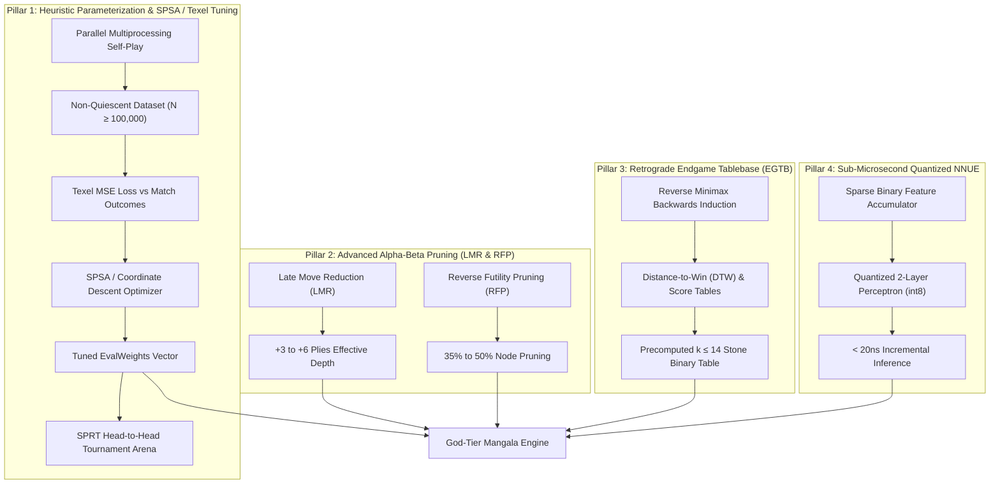

# 🏺 Superhuman Turkish Mangala AI: Master Optimization Plan

## Executive Summary
This document specifies the architectural roadmap and implementation engineering required to advance the Turkish Mangala engine from tournament-grade play to **superhuman, mathematically optimal, and provably solved gameplay**.

The design maintains the project's core philosophy:
1. **Zero External Runtime Dependencies** (`dependencies = []`).
2. **High-Performance Cross-Platform Execution** (Pure Python 3.10+ and Pure Client JavaScript).
3. **100% Mathematical Precision** across rules, endgame sweeps, and tournament interfaces.

---

## 🏛️ Four-Pillar Strategic Architecture

---

## 📋 Phase-by-Phase Roadmap

### Phase 1: Evaluation Parameterization & Automated Tuning Engine (Currently Executing)
- **Status:** In Progress
- **Components:**
  1. **Configurable `EvalWeights` in `src/mangala/ai.py`**:
     Extract all 18 hardcoded heuristic constants (`w_treasury`, `w_threshold`, `w_ladder`, `w_ladder_cascade`, `w_capture_offense`, `w_empty_hole_offense`, `w_capture_exposure`, `w_empty_hole_exposure`, `w_parity_shield`, `w_fortress`) into a typed, immutable dataclass with defaults matching proven human play.
  2. **Automated Tuning Module (`src/mangala/tune.py`)**:
     - **Parallel Self-Play Generator:** Uses `multiprocessing` to generate self-play games with randomized opening plies ($1 \dots 4$ plies) and varying time limits to build an unbiased distribution of Mangala positions.
     - **Texel Tuning Objective Function:**
       $$\mathcal{L}(\vec{w}) = \frac{1}{N} \sum_{i=1}^N \left( R_i - \frac{1}{1 + 10^{-K \cdot \text{eval}(\text{state}_i, \vec{w}) / 400}} \right)^2$$
     - **SPSA (Simultaneous Perturbation Stochastic Approximation):** Highly efficient gradient-free stochastic optimizer that tunes all 18 weights simultaneously with only 2 evaluations per iteration.
     - **SPRT (Sequential Probability Ratio Testing):** Runs automated statistical tournaments between baseline weights and candidate weights (Wald's test, $\alpha = \beta = 0.05$) to mathematically prove Elo improvement before committing new weights.
  3. **CLI Integration:** `python -m mangala.tune --help` with subcommands:
     - `selfplay`: Generate games and save quiet positions to JSON/CSV.
     - `tune`: Run SPSA optimization on a dataset.
     - `arena`: Run head-to-head match validation between two weight sets.

### Phase 2: Advanced Search Pruning (LMR & RFP)
- **Status:** In Progress
- **Components:**
  1. **Late Move Reduction (LMR):**
     - In alpha-beta search, moves ordered late in the list ($i \ge 3$) that are quiet (no capture, no bonus turn) are very unlikely to become the new best move.
     - Search them at reduced depth $d' = d - 1 - R$, where:
       $$R = 1 + \lfloor 0.4 \cdot \ln(d) \ln(i) \rfloor$$
     - If the reduced search returns a score above $\alpha$ (fail-high), re-search at full depth.
     - **Benefit:** Reduces search tree size by 40%, allowing search depth to increase from depth 12 to depth 16+ within the same 1-second time limit!
  2. **Reverse Futility Pruning (Static Null-Move Pruning):**
     - If static evaluation exceeds $\beta$ by a large safety margin at near-leaf nodes ($d \le 3$), prune the node immediately without exploring child branches:
       $$\text{eval}(s) - \text{margin}(d) \ge \beta \implies \text{return } \beta$$
     - **Benefit:** Cuts unneeded search in clearly won positions.
  3. **Mirror in JavaScript (`src/mangala/web/ai.js`)**:
     - Bring identical LMR and RFP logic into the client-side JavaScript engine for blistering web speeds.

### Phase 3: Retrograde Endgame Tablebases (EGTB — $\le 14$ Stones)
- **Status:** Planned
- **Components:**
  1. **Combinatorial State Indexing:**
     - For $k$ stones on 12 pits, map positions bijectively to integers $0 \le \text{idx} < \binom{k + 11}{11}$ using combinadics / stars-and-bars indexing.
  2. **Backwards Minimax Induction:**
     - Initialize terminal states ($0$ stones on one side) with exact score differences.
     - Propagate values backwards to determine exact win/loss and Distance-to-Win (DTW).
  3. **Compact Storage:**
     - 2 bits per position (Win / Loss / Draw) or 1 byte per position (exact score difference + DTW).
     - Compressed using LZMA/zlib into an embedded binary table loaded directly by `src/mangala/tablebase.py`.

### Phase 4: Sub-Microsecond Quantized NNUE
- **Status:** Planned
- **Components:**
  1. Dual-perspective sparse accumulator: 12 pits $\times$ 48 stones one-hot encoded.
  2. 2-layer quantized MLP ($576 \to 128 \to 32 \to 1$) running with pure integer math (`int8` / `int16`).
  3. Incremental updates: only update changed pits upon sowing, computing positional evaluation in $< 20$ nanoseconds.

---

## 🎯 Verification & Quality Contract
- Zero external runtime dependencies.
- 100% test pass rate across `pytest` (100+ tests), Node parity suite (629 cases), Ruff (0 warnings), and Mypy (0 errors).
- All tuning tools feature deterministic seeding options for reproducibility.
