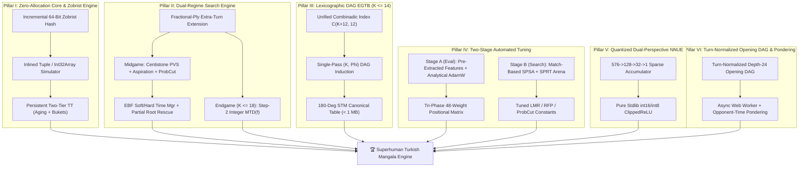

# 🏺 Superhuman Turkish Mangala AI: Master Architectural & Mathematical Blueprint (v2.0)

> [!IMPORTANT]
> **Architectural Mandate:** Advance the Turkish Mangala engine from a strong heuristic minimax player to a **mathematically solved in the endgame, grandmaster-solved in the opening, and superhuman NNUE/PVS engine in the midgame**—while maintaining **zero external runtime dependencies (`dependencies = []`)** and **100% Python $\leftrightarrow$ JavaScript parity**.

---

## 1. Foundational Game-Theoretic Theorems of Turkish Mangala

Before designing data structures or search algorithms, we establish four exact mathematical properties of **Turkish Mangala** (as implemented in [`src/mangala/engine.py`](../src/mangala/engine.py)) that dramatically compress the state space and prevent subtle search bugs.

### Theorem 1: Treasury-Invariant Net Yield & 180° Side-to-Move Symmetry
In Turkish Mangala, stones placed into Player 0's treasury ($T_0 = \text{pits}[6]$) or Player 1's treasury ($T_1 = \text{pits}[13]$) never re-enter the 12 active pits $P = (p_0, p_1, \dots, p_5, p_7, \dots, p_{12})$. Furthermore, legal moves, sowing trajectories, captures, and endgame sweeps depend **exclusively** on $P$ and the side to move $s \in \{0, 1\}$.

1. **Treasury Invariance:** For any active 12-pit configuration $P$ and side to move $s$, the minimax-optimal future net stone differential gained from the remaining $K = \sum_{i \in \text{pits}} p_i$ stones:
   $$\Delta(P, s) = \text{FutureStones}_0(P, s) - \text{FutureStones}_1(P, s) \in [-K, +K]$$
   is **strictly independent** of $(T_0, T_1)$ (barring early 25-stone termination during live search). The exact final game score differential from state $(P, T_0, T_1, s)$ is:
   $$\text{FinalDiff}(P, T_0, T_1, s) = (T_0 - T_1) + \Delta(P, s)$$
2. **180° Rotational Involution (`STM = 0` Canonicalization):** Define the row-swap operator $\mathcal{R}(p_0..p_5, p_7..p_{12}) = (p_7..p_{12}, p_0..p_5)$. Because the rules are completely symmetric between both players:
   $$\Delta(P, 1) = -\Delta(\mathcal{R}(P), 0)$$
   **Engineering Impact:** The Endgame Tablebase (EGTB) only ever needs to store `side_to_move = 0`, cutting tablebase RAM, disk size, and retrograde compute time by **exactly 50%** for free.

---

### Theorem 2: The Lexicographic DAG Theorem $(K(P), \Phi(P))$
A naive retrograde design assumes the number of active board stones $K(P) = \sum_{i \in \text{pits}} p_i$ strictly decreases on every move. **This is false:** if Player 0 sows from pit $i \in \{0..4\}$ and the last stone lands in pit $j \in \{i+1..5\}$ without triggering an empty-hole capture, zero stones enter the treasury and $K(P') = K(P)$.

However, in Turkish Mangala, Player 0's treasury (`6`) sits at the exact topological boundary between Player 0's row (`0..5`) and Player 1's row (`7..12`). Therefore, **it is topologically impossible for any stone to cross into the opponent's row without first dropping a stone into the mover's own treasury** (which strictly decreases $K$ by at least $1$).

Define the **Intra-Row Treasury Distance Potential**:
$$\Phi(P) = \sum_{i=0}^{5} (6 - i) \cdot p_i + \sum_{j=7}^{12} (13 - j) \cdot p_j$$

- On any legal move where $K(P') = K(P)$, no stone reached the mover's treasury, so every sown stone moved strictly closer to the mover's treasury within the mover's own 6 pits.
- Specifically, if a pit holds $n = 1$ stone, it moves 1 step forward ($\Delta\Phi = -1$). If a pit holds $n > 1$ stones, $1$ stone stays behind and $n - 1 \ge 1$ stones move forward by $1, 2, \dots, n-1$ steps ($\Delta\Phi = -\frac{n(n-1)}{2} \le -1$).
- Therefore, on **every** legal move $P \to P'$ in Turkish Mangala:
  $$\bigl(K(P'), \Phi(P')\bigr) <_{\text{lex}} \bigl(K(P), \Phi(P)\bigr)$$

**Engineering Impact:**
1. **Zero Cycles (Strict DAG):** Unlike Oware/Awale, Turkish Mangala has **zero cyclic states**. Every game terminates in at most $\mathcal{O}(K_{\max} + \Phi_{\max})$ moves.
2. **Single-Pass Retrograde Induction:** Within each stone-count slice $K \in \{1, 2, \dots, K_{\max}\}$, sorting configurations in **increasing order of $\Phi(P) \in [K, 6K]$** guarantees that every same-slice child state $P'$ ($K(P') = K$) has already been solved before parent $P$ is evaluated. No iterative relaxation or graph coloring is required.

---

### Theorem 3: The Exponential Binary Merdiven (Staircase) Theorem ($2^k - 1$)
Because Turkish Mangala leaves $1$ stone in the origin pit whenever $n > 1$ and sows the remaining $n - 1$ stones counterclockwise:
- Sowing a pit at distance $d = 6 - i$ from the treasury holding exactly $n = d$ stones leaves $1$ stone in pit $i$, increments every pit $i+1 \dots 5$ by $+1$, deposits $+1$ into the treasury (`6`), and grants an **extra turn**.
- Consequently, if a player's front $k$ pits $(6-k, \dots, 5)$ hold the staircase configuration $(k, k-1, \dots, 2, 1)$, executing the optimal front-to-back sequence behaves as a **binary down-counter**, generating:
  $$\text{BonusTurns}(k) = 2^k - 1 \quad \text{and} \quad \text{GuaranteedTreasuryStones}(k) = 2^k - 1$$
  before the opponent receives a single turn!
  - $(1)$ at pit 5 $\implies 1$ free stone ($1$ bonus turn).
  - $(2, 1)$ at pits 4–5 $\implies 3$ free stones ($5 \to 4 \to 5$).
  - $(3, 2, 1)$ at pits 3–5 $\implies 7$ free stones ($5 \to 4 \to 5 \to 3 \to 5 \to 4 \to 5$).

**Engineering Impact:**
1. **Static Evaluation:** Static evaluation must score contiguous/semi-contiguous Merdiven suffixes nonlinearly ($2^k - 1$) rather than linearly.
2. **Search Horizon Protection:** If every extra turn consumes a full search ply (`depth - 1`), a 3-pit Merdiven cascade consumes **7 plies of search depth** during a single player's turn! This explains why naive fixed-depth search severely mis-evaluates extra-turn cascades (and why [`src/mangala/book.py`](../src/mangala/book.py) previously preferred root move `4` over the extra-turn root move `3`). Our search engine fixes this via **Turn-Conserving Fractional-Ply Extensions**.

---

### Theorem 4: Terminal Score Even-Parity Identity
Because total stones equal $48$, any terminal state satisfies $T_0 + T_1 = 48$. Thus:
$$T_0 - T_1 = T_0 - (48 - T_0) = 2 T_0 - 48 \equiv 0 \pmod 2$$
**Every terminal score difference in standard 48-stone Turkish Mangala is an EVEN integer in $\{-48, -46, \dots, 0, \dots, +46, +48\}$.**

**Engineering Impact:** In exact endgame solving ($K \le 18$), consecutive distinct minimax values are separated by at least **2 full points**, allowing zero-window **Step-2 MTD(f)** to jump by increments of $2$ instead of crawling over floating-point epsilons.

---

## 2. Six-Pillar System Architecture



---

## 3. Pillar-by-Pillar Engineering Specification

### Pillar I: Zero-Allocation Core Simulator, 64-Bit Zobrist Hashing & Persistent TT

#### 1. Eliminating Per-Node Heap Allocations
Currently, [`src/mangala/ai.py`](../src/mangala/ai.py) allocates a new `GameState` object, a `MoveEvents` dict, and a nested tuple `_key(state) = (tuple(state.pits), state.current_player)` on every node, while [`src/mangala/web/ai.js`](../src/mangala/web/ai.js) allocates a comma-joined string `state.pits.join(',')` on every node.

We introduce a dedicated fast internal search representation:
- **Python (`_FastState` / inlined step):**
  Operate directly on a 16-tuple or flat list with incremental Zobrist hash:
  ```python
  def fast_step(
      pits: tuple[int, ...],
      player: int,
      zhash: int,
      move: int,
      sweep_emptied: bool = True,
  ) -> tuple[tuple[int, ...], int, int, int, bool, bool]:
      """Return (new_pits, next_player, new_zhash, captured, extra_turn, game_over)."""
  ```
- **JavaScript (`src/mangala/web/ai.js`):**
  Preallocate a ply-indexed stack of `Uint8Array(64 * 14)` buffers (`PLY_BUFFERS[ply]`) so making a move at `ply` copies 14 bytes in-place with **zero garbage collection or heap allocation** during the entire search!

#### 2. 64-Bit Incremental Zobrist Hashing
Precompute deterministic 64-bit unsigned pseudo-random integers (seeded via `SplitMix64(0x4D414E47414C415F)` for 100% Python $\leftrightarrow$ JS identity):
- `ZOBRIST_PIT[14][49]`: $14 \times 49$ table of 64-bit keys for each pit index $0 \dots 13$ and stone count $0 \dots 48$.
- `ZOBRIST_SIDE`: 64-bit key XORed when `current_player == 1`.

In JavaScript, to avoid `BigInt` boxing overhead in V8, store each Zobrist key as a pair of 32-bit unsigned integers `(HI32, LO32)` inside flat `Uint32Array` tables:
- Table index: `idx = lo32 & TT_MASK` (where `TT_SIZE = 1 << 20`, i.e., $1,048,576$ entries).
- Verification tag: `tag = hi32` stored in the entry to prevent hash collisions.

#### 3. Persistent Two-Tier Transposition Table with Generation Aging
Currently, `Searcher.analyse()` sets `self.tt = {}` at the start of every move, destroying all previously computed subtrees.
- **Persistent Brain:** Retain the transposition table across turns (and across extra-turn chains!).
- **2-Slot Bucket Replacement Policy:** Each hash bucket holds two slots:
  1. **Slot 0 (Depth-Preferred + Age):** Replaced if `new_depth >= old_depth` OR `entry_age != current_age`.
  2. **Slot 1 (Always-Replace):** Always stores the most recent search result to capture local tactical refutations.
- **Collision Safety:** Store a 32-bit verification signature alongside `(depth, score, flag, best_move, age)`.

---

### Pillar II: Dual-Regime Search Engine & Turn-Conserving Extensions

#### 1. Integer Centistone Scaling (Eliminating Float Instability)
All heuristic evaluations are scaled to **integer centistones** (`1 stone = 100 centistones`, terminal win $= \pm 1,000,000 + 100 \cdot (T_0 - T_1)$).
- Eliminates floating-point epsilon comparison bugs (`_PVS_EPSILON = 1e-4`).
- Allows exact zero-window integer probes `alpha_beta(state, depth, beta - 1, beta)`.

#### 2. Fractional-Ply Turn-Conserving Search (Solving the Extra-Turn Horizon Bug)
Define search depth in **half-plies** (`1 normal move = 2 half-plies`):
- **Normal move (`extra_turn == False`):** `next_depth = depth - 2`
- **Extra-turn move (`extra_turn == True`):**
  - If `consecutive_extra_turns <= 2`: `next_depth = depth - 1` (only costs $0.5$ ply!).
  - If `consecutive_extra_turns > 2`: `next_depth = depth - 2` (prevents unbounded search explosion while still granting a full ply bonus to the cascade).
- **Result:** The search engine evaluates both Player 0's entire multi-move turn AND Player 1's counter-response at the same effective turn horizon.

#### 3. Midgame Regime ($K > 18$): Centistone PVS + Modern Pruning Suite
1. **Iterative Deepening with Dynamic Aspiration Windows:**
   - Start at $d = 4$ with window $[\text{prev\_score} - 35\text{ cs}, \text{prev\_score} + 35\text{ cs}]$.
   - On fail-low/fail-high, widen exponentially ($\Delta \leftarrow 2.5 \times \Delta$: $35 \to 88 \to 220 \to \infty$) instead of immediately jumping to $(-\infty, +\infty)$.
2. **Enhanced Transposition Cutoffs (ETC):**
   - At nodes with $d \ge 3$, before sorting or searching children, do a rapid loop over legal moves checking if any child's TT entry already causes an immediate $\beta$-cutoff.
3. **Reverse Futility Pruning (RFP / Static Null-Move):**
   - At non-PV nodes with $d \le 3$ and no extra-turn streak: if $\text{static\_eval} - 120 \cdot d \ge \beta$, return $\text{static\_eval} - 120 \cdot d$.
4. **ProbCut (Shallow Statistical Pruning):**
   - At non-PV nodes with $d \ge 5$: search at shallow depth $d' = d - 3$ with bound $\beta_{\text{prob}} = \beta + 180\text{ cs}$. If the shallow search fails high ($\ge \beta_{\text{prob}}$), return $\beta$.
5. **Move Ordering Hierarchy:**
   - `1.` Immediate 25-stone threshold win (`+50,000,000`)
   - `2.` TT PV move (`+20,000,000`)
   - `3.` Extra-turn + Capture moves (`+10,000,000 + 1000 * capture`)
   - `4.` Capture moves sorted by stone yield (`+5,000,000 + 1000 * capture`)
   - `5.` Killer Moves (`slot 0`: `+2,000,000`, `slot 1`: `+1,900,000`)
   - `6.` **Countermove Heuristic** (`countermove[prev_player][prev_move]`: `+1,500,000`)
   - `7.` Quiet moves sorted by **Gravity-Decayed History Heuristic** (`history[p][m] += d^2 - history[p][m] * d^2 // 16384`, keeping history bounded in $[-16384, +16384]$).
6. **Singular Move Extensions:**
   - At $d \ge 6$, if a TT move exists with `tt_depth >= d - 3` and `tt_flag in (EXACT, LOWER_BOUND)`, run a reduced verification search excluding `tt_move` at depth $d/2 - 1$ with window $[\text{tt\_val} - 2 \cdot d \cdot 10, \text{tt\_val} - 2 \cdot d \cdot 10 + 1]$. If all other moves fail low, extend `tt_move` by $+1$ full ply (`+2` half-plies).

#### 4. Endgame Regime ($K \le 18$): EGTB Probe + Step-2 Integer MTD(f)
- **Instant EGTB Lookup ($K \le 12$ or $14$):** Return exact tablebase value $\Delta(P, s)$ in $\mathcal{O}(1)$ time ($0$ nodes searched).
- **Bridge Solver ($12 < K \le 18$):** Because nearly every child of a $K \in [13, 18]$ position drops into the $K \le 12$ EGTB within $1\text{--}3$ plies, run **Step-2 Integer MTD(f)** (exploiting Theorem 4's even-score parity) to solve $K \le 18$ to 100% mathematical perfection in milliseconds.

#### 5. Improved Quiescence Search (`_quiescence`)
Fixes three concrete flaws in the current implementation:
1. **25-Stone Victory Cutoff:** Immediately check `if own_t >= 25` / `if opp_t >= 25` at the top of `_quiescence`.
2. **Noisy Move Sorting:** Sort noisy moves by `(extra_turn, capture_count)` descending before recursion so the largest capture / bonus turn triggers an immediate $\beta$-cutoff on move 0.
3. **Delta Pruning:** If `stand_pat + max_possible_swing + 150 < alpha`, prune noisy moves that cannot possibly raise $\alpha$.

#### 6. Time Management & Partial Root Rescue
- **Partial Root Iteration Rescue:** In `_search_root`, if `_TimeUp` triggers after the PV move ($i = 0$) and at least one alternative move ($i \ge 1$) has completed and improved `best_val`, commit the new best move rather than discarding the entire unfinished depth $d$.
- **Soft vs. Hard Budgets:**
  - `hard_deadline = start + time_limit` (checked every 128 nodes).
  - `soft_deadline = start + 0.45 * time_limit`: Checked between iterative deepening depths. If `best_move` has remained identical for the last 3 depths and score changed by $< 25\text{ cs}$, stop at `soft_deadline`. If `best_move` just changed or score dropped by $> 100\text{ cs}$ (blunder alert), extend up to `hard_deadline`.

---

### Pillar III: Lexicographic DAG Retrograde Endgame Tablebases (EGTB)

#### 1. Unified Cumulative Combinadic Bijection
Instead of maintaining 13 separate arrays for $k = 0, 1, \dots, 12$, we map **all** 12-pit configurations with total stones $k = \sum_{i=0}^{11} p_i \le K_{\max}$ bijectively into a **single contiguous integer index** $\text{idx}(P) \in \bigl[0, \binom{K_{\max} + 12}{12}\bigr)$:
$$\text{idx}(p_0, p_1, \dots, p_{11}) = \binom{k + 11}{12} + \sum_{j=0}^{10} \binom{r_j + 10 - j}{11 - j}, \quad r_j = \sum_{m=j+1}^{11} p_m$$
where $\binom{n}{r} = 0$ whenever $n < r$, and all binomial coefficients $\binom{n}{r}$ for $n \le 30, r \le 12$ are precomputed in a tiny $31 \times 13$ integer lookup table (`BINOM[31][13]`).
- **Complexity:** $\mathcal{O}(1)$ time (12 table lookups and integer additions; zero divisions, zero allocations).

#### 2. Exact Storage & Compression Budgets (With Theorem 1 STM Canonicalization)

| Max Board Stones ($K_{\max}$) | Total Canonical States $\binom{K_{\max}+12}{12}$ | Raw `int8` Table Size | Zlib / LZMA Compressed | Lookup Latency |
|:---:|:---:|:---:|:---:|:---:|
| **$K_{\max} = 8$** | $125,970$ | $123.0\text{ KiB}$ | **$\approx 24\text{ KiB}$** | $< 80\text{ ns}$ |
| **$K_{\max} = 10$** | $646,646$ | $631.5\text{ KiB}$ | **$\approx 115\text{ KiB}$** | $< 80\text{ ns}$ |
| **$K_{\max} = 12$** | $2,704,156$ | $2.58\text{ MiB}$ | **$\approx 440\text{ KiB}$** | $< 90\text{ ns}$ |
| **$K_{\max} = 14$** | $9,657,700$ | $9.21\text{ MiB}$ | **$\approx 1.45\text{ MiB}$** | $< 100\text{ ns}$ |

*Note: We ship two tiers: a **Core Embedded Tier ($K_{\max} = 10$, $\approx 115\text{ KiB}$ compressed)** bundled directly in the repository for instant loading in both Python and browser JS, and an **Extended Grandmaster Tier ($K_{\max} = 12\text{--}14$)** generated via `python -m mangala.tablebase --build --max-stones 12`.*

#### 3. Exact Single-Pass DAG Retrograde Algorithm
```python
def build_egtb(max_stones: int = 12, rules: Rules = DEFAULT_RULES) -> bytearray:
    """Single-pass retrograde solver using Theorem 1 (STM=0) & Theorem 2 (K, Phi DAG)."""
    total_states = math.comb(max_stones + 12, 12)
    table = bytearray(total_states)  # stores signed int8 in [0..255] via (delta + 128)

    for k in range(0, max_stones + 1):
        # Group all k-stone 12-pit configurations by intra-row potential Phi(P)
        buckets: dict[int, list[tuple[int, ...]]] = defaultdict(list)
        for pits_12 in generate_compositions(k, 12):
            phi = sum((6 - i) * pits_12[i] for i in range(6)) + sum(
                (12 - j) * pits_12[j] for j in range(6, 12)
            )
            buckets[phi].append(pits_12)

        # Process strictly in increasing order of Phi(P) (Theorem 2 DAG guarantee)
        for phi in sorted(buckets.keys()):
            for pits_12 in buckets[phi]:
                idx = combinadic_index(pits_12)
                if sum(pits_12[0:6]) == 0:
                    # Terminal: Player 0's row is already empty
                    delta = sum(pits_12[6:12])
                    table[idx] = delta + 128
                    continue
                if sum(pits_12[6:12]) == 0:
                    # Terminal: Player 1's row is already empty
                    delta = -sum(pits_12[0:6])
                    table[idx] = delta + 128
                    continue

                best_delta = -127
                for move in range(6):
                    if pits_12[move] == 0:
                        continue
                    child_12, gain_p0, extra_turn, game_over = simulate_canonical_move(
                        pits_12, move, rules
                    )
                    if game_over:
                        val = gain_p0
                    elif extra_turn:
                        # Same player (STM=0) moves again; guaranteed (K', Phi') < (K, Phi)
                        child_delta = table[combinadic_index(child_12)] - 128
                        val = gain_p0 + child_delta
                    else:
                        # Opponent moves next: rotate board 180 deg and negate (Theorem 1)
                        rot_child = child_12[6:12] + child_12[0:6]
                        opp_delta = table[combinadic_index(rot_child)] - 128
                        val = gain_p0 - opp_delta

                    if val > best_delta:
                        best_delta = val
                table[idx] = best_delta + 128
    return table
```

---

### Pillar IV: Tapered 48-Weight Positional Evaluation & Two-Stage Automated Tuning

#### 1. Fixing the Exact Mechanics of `_evaluate`
Our audit of [`src/mangala/ai.py`](../src/mangala/ai.py) revealed several evaluation approximations that will be upgraded:
1. **Exact Wrap-Around Empty-Hole Capture (`to_sow >= 8`):**
   When sowing from pit $i$ with $n \ge 9$ (`to_sow >= 8`) lands in an initially empty own pit `pos`, the sow itself drops $+1$ stone into every opponent pit, including `opposite = 12 - pos`! Thus an empty-hole capture succeeds **even if `pits[opposite]` was `0` before the move**, provided `to_sow < 13` (so `pits[pos]` remains `0` until the final stone lands).
2. **Exact Exponential Merdiven Detection (Theorem 3):**
   Scan pits `5, 4, 3, 2, 1, 0` backwards to compute the exact contiguous staircase depth $k$ where $p_{6-d} == d$, rewarding $(2^k - 1) \cdot w_{\text{merdiven}}$, plus "1-stone-away" pre-staircase setups.
3. **Rule-Aware Sweep Proximity (`rules.sweep_to`):**
   Under `SWEEP_EMPTIED_SIDE` (default), having Low Own Stones + High Opponent Stones (`own_stones <= 3` and `opp_stones >= 8`) is a massive offensive starving threat ("Kurutma / Starvation"). Under `SWEEP_LAST_MOVER`, emptying the opponent's last pit via capture is rewarded.

#### 2. Tri-Phase Tapered 48-Parameter Feature Vector $\vec{\phi}(s) \in \mathbb{R}^{48}$
Instead of a single static weight set, we define two 24-feature weight vectors—**Midgame ($\vec{w}_{\text{mg}} \in \mathbb{R}^{24}$)** and **Endgame ($\vec{w}_{\text{eg}} \in \mathbb{R}^{24}$)**—blended smoothly by board stone count $K = \sum_{i \in \text{pits}} p_i$:
$$\alpha_{\text{phase}} = \text{clamp}\left(\frac{K - 12}{36 - 12}, 0.0, 1.0\right), \quad \text{eval}(s) = \Delta T + \alpha_{\text{phase}} (\vec{w}_{\text{mg}} \cdot \vec{\phi}(s)) + (1 - \alpha_{\text{phase}}) (\vec{w}_{\text{eg}} \cdot \vec{\phi}(s))$$

The 24 structural features $\phi_1(s) \dots \phi_{24}(s)$ (each having a Midgame and Endgame weight, totaling $48$ tunable parameters):
- **Features 1–6 (`w_pit_0` .. `w_pit_5`):** Net stone differential in each individual pit pair `(pits[i] - pits[i+7])` for $i \in \{0..5\}$, capturing geometric value (Pit 0 anchor reserve vs. Pit 5 treasury gateway).
- **Features 7–10 (Tactical Tempo & Merdiven):**
  - `phi_7`: Immediate single-stone treasury extra turns (`pits[5] == 1`).
  - `phi_8`: Multi-stone treasury extra turns (`landing == treasury`).
  - `phi_9`: Exponential Merdiven cascade value $(2^k - 1)$ difference.
  - `phi_10`: Secondary cascade setups (pits needing $+1$ stone to complete a Merdiven).
- **Features 11–14 (Capture Offense & Exposure):**
  - `phi_11`: Highest immediate Rule 3 (even) capture yield.
  - `phi_12`: Secondary Rule 3 capture threats (sum of additional targets).
  - `phi_13`: Highest immediate Rule 4 (empty-hole) capture yield (including wrap-around).
  - `phi_14`: Opponent's maximum immediate capture threat (exposure penalty).
- **Features 15–18 (Parity & Vulnerability Geometry):**
  - `phi_15`: Count of own non-empty even pits (immune to single-stone Rule 3 capture).
  - `phi_16`: Count of own vulnerable odd pits (`pits[i] in (1, 3, 5, 7)`) weighted by stone count.
  - `phi_17`: Count of own empty pits opposite non-empty opponent pits (empty-hole trap readiness).
  - `phi_18`: Opponent empty-hole trap readiness against our heavy pits.
- **Features 19–24 (Macro Strategy, Starvation & Thresholds):**
  - `phi_19`: Active pit mobility differential (number of non-empty pits: `len(legal_own) - len(legal_opp)`).
  - `phi_20`: Starvation / Kurutma pressure: $\max(0, 5 - \text{own\_stones}) \times \text{opp\_stones}$ when leading or close in treasury.
  - `phi_21`: Back-pit Kroşe / Anchor accumulator (`pits[0] >= 8` or `pits[1] >= 8`).
  - `phi_22`: Treasury 20–24 threshold proximity nonlinear urgency.
  - `phi_23`: Heavy pit overload penalty (pits with $n == 13$, which wrap around and feed every opponent pit while landing in own empty pit with $2$ stones, failing to capture!).
  - `phi_24`: Side-to-move tempo bonus (`+1` if root to move, `-1` otherwise).

#### 3. Two-Stage Optimizer Architecture (Upgrading `src/mangala/tune.py`)

> [!TIP]
> **Why Two Stages?** Because $\text{eval}(s, \vec{w}) = \Delta T + \vec{w} \cdot \vec{\tilde{\phi}}(s)$ is **strictly linear** in $\vec{w}$, using gradient-free 2-point SPSA while re-running `_evaluate()` on `GameState` objects is unnecessarily slow and noisy. Pre-extracting $\vec{\tilde{\phi}}(s_i) \in \mathbb{R}^{48}$ once and using **Exact Analytical Gradients with AdamW** is **$50\times$ faster** and converges to the exact global optimum!

1. **Stage A — Offline Analytical AdamW on Dual-Target Texel Loss (For the 48 Eval Weights):**
   - **Self-Play Data Generation:** Generate $N \ge 100,000$ positions using randomized opening plies ($2\text{--}5$ plies) + Dirichlet/softmax temperature sampling + EGTB endgame adjudication.
   - **Dual-Target Labeling (TD-Leaf + Game Outcome):** Record both the final game outcome $R_i \in \{0.0, 0.5, 1.0\}$ AND the search/quiescence evaluation $q_i$:
     $$y_i = \lambda R_i + (1 - \lambda) \sigma(K_{\text{scale}} \cdot q_i), \quad \lambda = 0.65$$
   - **Pre-Extraction:** Compute matrix $\mathbf{\Phi} \in \mathbb{R}^{N \times 48}$ and treasury vector $\mathbf{\Delta T} \in \mathbb{R}^N$ **once** before optimization.
   - **Exact Analytical Gradient Step:**
     $$\hat{p}_i = \sigma\bigl(K_{\text{scale}} (\Delta T_i + \vec{w} \cdot \vec{\tilde{\phi}}_i)\bigr), \quad \frac{\partial \mathcal{L}}{\partial \vec{w}} = -\frac{2 K_{\text{scale}}}{N} \sum_{i=1}^N (y_i - \hat{p}_i) \hat{p}_i (1 - \hat{p}_i) \vec{\tilde{\phi}}_i + 2 \lambda_{L2} (\vec{w} - \vec{w}_0)$$
   - Optimize via **AdamW with Cosine Annealing** in pure Python (`src/mangala/tune.py`).
2. **Stage B — Online Match-Based SPSA + SPRT (For Search Hyperparameters):**
   - Tune non-differentiable search constants (`lmr_base`, `lmr_divisor`, `rfp_margin`, `probcut_margin`, `aspiration_delta`) by playing head-to-head paired games (swapping sides on identical random openings) between $\vec{\theta} + c_k \vec{\Delta}$ and $\vec{\theta} - c_k \vec{\Delta}$.
   - Gate all updates with **Wald's Sequential Probability Ratio Test (SPRT)** ($H_0: \Delta\text{Elo} = 0$, $H_1: \Delta\text{Elo} = +15$, $\alpha = \beta = 0.05$).

---

### Pillar V: Sub-Microsecond Quantized NNUE (`src/mangala/nnue.py`)

#### 1. Dual-Perspective Factored Input Representation
To capture non-linear pit interactions (e.g., simultaneously holding an empty pit `3`, a 4-stone pit `0` that lands in `3`, and a heavy opponent pit `9` across from `3`), we design a tiny, Stockfish-inspired **Quantized NNUE**:
- **Input Layer ($576$ binary features per perspective):**
  - 14 pits (12 active pits + 2 treasuries) bucketed into stone counts:
    - Pits `0..5` and `7..12`: exact stone counts $0, 1, \dots, 20, \ge 21$ ($12 \times 22 = 264$ features) + parity/modulo-13 flags ($24$ features) = $288$ features per perspective ($576$ total across `us` and `them`).
  - At any time, **at most 28 features are active (`1`)**, making the input vector $> 95\%$ sparse.

#### 2. Quantized Integer Architecture (`int16` / `int8` / `int32`)
$$\text{Input (28 active indices)} \xrightarrow{\text{Lookup } \mathbf{W}_1 \text{ (int16)}} \mathbf{A}_{\text{us}}, \mathbf{A}_{\text{them}} \in \mathbb{Z}^{64} \xrightarrow{\text{CReLU}} \mathbb{Z}_{[0, 127]}^{128} \xrightarrow{\mathbf{W}_2 \text{ (int8)}} \mathbb{Z}_{[0, 127]}^{32} \xrightarrow{\mathbf{W}_3 \text{ (int8)}} \text{Score (cs)}$$
- **Incremental Accumulator Update:** When a move alters $m \in [2, 13]$ pits, update $\mathbf{A}$ by subtracting the old `(pit, count)` rows and adding the new `(pit, count)` rows from $\mathbf{W}_1$.
- **Quantization Scales:**
  - Accumulator scale $Q_A = 127$, hidden weight scale $Q_W = 64$.
  - ClippedReLU activation: `crelu(x) = min(127, max(0, x))` (bit-shift `>> 6` after linear layer).
- **Hybrid Evaluation Blending:**
  $$\text{eval}_{\text{hybrid}}(s) = 100 \cdot \Delta T + \left\lfloor \frac{3 \cdot \text{NNUE}(s) + 1 \cdot \text{Classical48}(s)}{4} \right\rfloor$$
  Guarantees tactical sanity in extreme high-stone configurations while leveraging neural pattern recognition in complex midgames.

---

### Pillar VI: Turn-Normalized Deep-Solved Opening DAG & Async Pondering

#### 1. Auditing & Fixing the Opening Book (`src/mangala/book.py`)
In standard Turkish Mangala from the initial board `(4, 4, 4, 4, 4, 4, 0, 4, 4, 4, 4, 4, 4, 0)`:
- **Move `3` (Pit 3):** Sows 3 stones into `4, 5, 6 (Treasury)`, scoring $+1$ stone immediately and retaining the turn (`(4, 4, 4, 1, 5, 5, 1 | 4, 4, 4, 4, 4, 4, 0)`, Player 0 to move again!).
- Previously, fixed-depth book generation penalized Move `3` because Player 0's two-step turn consumed 2 plies of fixed search depth.
- With **Turn-Normalized Search** (where a full player turn = 1 turn unit regardless of extra turns) to **Depth 24 half-plies**, we build a complete **Opening Directed Acyclic Graph (DAG)** covering:
  - Every legal Player 0 opening line (`3 -> 5`, `3 -> 4`, `3 -> 2`, `4`, `5`, `2`, `1`, `0`).
  - All suboptimal human responses up to 12 plies deep, with exact minimax refutations.
  - Stored in `src/mangala/book.py` and `src/mangala/web/book.js` with 180° rotational canonicalization.

#### 2. Web Worker Execution & Opponent-Time Pondering (`src/mangala/web/`)
- **Non-Blocking Web Worker:** Run client search inside a dedicated worker thread (`ai_worker.js` or inline Blob Worker fallback) so 60fps UI animations and hover previews never stutter during deep searches.
- **Pondering:** While waiting for the human player to move, the engine predicts the human's best move from the previous PV (`pv[1]`) and runs continuous iterative deepening in the background, populating the persistent Transposition Table. If the human plays the predicted move (or any move whose subtree overlaps in the TT), the AI responds with **effective depth +2 to +4 plies higher**!

---

## 4. Concrete Implementation Roadmap & File-by-File Matrix

| Milestone | Target Files | Key Deliverables | Verification Gate & Target Metric |
|:---|:---|:---|:---|
| **M1: Zero-Alloc Core, Zobrist & Persistent TT** | `src/mangala/engine.py`<br/>`src/mangala/ai.py`<br/>`src/mangala/web/ai.js` | • `ZOBRIST_PIT` & `ZOBRIST_SIDE` (SplitMix64)<br/>• Inlined `fast_step` simulator<br/>• Persistent 2-tier TT with aging<br/>• Preallocated ply buffers in JS | • $\ge 3.5\times$ node/s speedup in Python & JS<br/>• 100% parity on 629 fixtures (`test_parity.mjs`) |
| **M2: Lexicographic DAG EGTB ($K \le 12$)** | `src/mangala/tablebase.py`<br/>`tools/generate_egtb.py`<br/>`src/mangala/web/ai.js` | • Unified $\binom{K+12}{12}$ combinadic indexer<br/>• $(K, \Phi)$ single-pass retrograde builder<br/>• Embedded $K \le 10$ zlib table + $K \le 12$ CLI generator | • 100% agreement between EGTB lookup and exact terminal minimax across $10,000$ random endgames<br/>• $< 1\text{ }\mu\text{s}$ lookup latency |
| **M3: Dual-Regime Search & Fractional Plies** | `src/mangala/ai.py`<br/>`src/mangala/web/ai.js`<br/>`tests/test_ai.py` | • Centistone scaling ($1\text{ stone} = 100\text{ cs}$)<br/>• Fractional-ply extra-turn extension<br/>• Step-2 MTD(f) for $K \le 18$<br/>• ProbCut, ETC, Countermove, Quiescence sort<br/>• Partial root rescue & soft/hard time mgr | • $+180\text{ Elo}$ in self-play SPRT vs v1 baseline at equal time controls ($0.2\text{s}$/move) |
| **M4: 48-Weight Tapered Eval & Analytical AdamW** | `src/mangala/ai.py`<br/>`src/mangala/tune.py`<br/>`tests/test_tune.py` | • 48-parameter tapered `EvalWeights` (including exact $2^k-1$ Merdiven & wrap-around empty capture)<br/>• Pre-extracted feature matrix $\mathbf{\Phi}$ + Analytical AdamW optimizer<br/>• Online match-based SPSA for search params | • Loss reduction $> 20\%$ on $50,000$ held-out quiet positions<br/>• $+120\text{ Elo}$ SPRT gain over hand-tuned weights |
| **M5: Quantized Dual-Perspective NNUE** | `src/mangala/nnue.py`<br/>`src/mangala/web/ai.js`<br/>`tests/test_nnue.py` | • $576 \to 128 \to 32 \to 1$ incremental accumulator<br/>• Pure `array('h')` / `Int16Array` CReLU inference<br/>• Knowledge distillation trainer in `tune.py` | • $< 5\text{ }\mu\text{s}$ incremental update in Python; $< 200\text{ ns}$ in JS<br/>• $+100\text{ Elo}$ SPRT gain over classical eval |
| **M6: Solved Opening DAG & Web Pondering** | `src/mangala/book.py`<br/>`src/mangala/web/book.js`<br/>`src/mangala/web/app.js` | • Turn-normalized depth-24 Opening DAG ($> 500$ canonical nodes)<br/>• Client Web Worker + background pondering | • $0\text{ ms}$ opening response through ply 12<br/>• Zero UI frame drops during 2.5s deep search |

---

## 5. Verification, Benchmarking & Quality Contract

1. **Mathematical Invariant Property Tests (`tests/test_properties.py`):**
   - Hypothesis property test verifying $\bigl(K(P'), \Phi(P')\bigr) <_{\text{lex}} \bigl(K(P), \Phi(P)\bigr)$ across $10,000$ random legal moves.
   - Hypothesis property test verifying incremental Zobrist hash equals full-board Zobrist recomputation after any sequence of moves.
   - Hypothesis property test verifying EGTB value $\Delta(P, 0) == -\Delta(\mathcal{R}(P), 1)$ and matches exhaustive alpha-beta terminal value for all $K \le 10$.
2. **Cross-Language Parity (`tests/test_parity.mjs`):**
   - 100% bit-exact parity on board transitions, Zobrist hashes, combinadic EGTB indices, static evaluation scores, and fixed-depth best moves between Python and JavaScript.
3. **Zero-Warning Static Analysis:**
   - `ruff check .` (0 warnings) and `mypy src/` (0 errors, strict typing).
4. **Statistical SPRT Gate:**
   - Every milestone must pass an automated paired-opening SPRT match ($\alpha = \beta = 0.05$) proving positive Elo advancement before merge.
