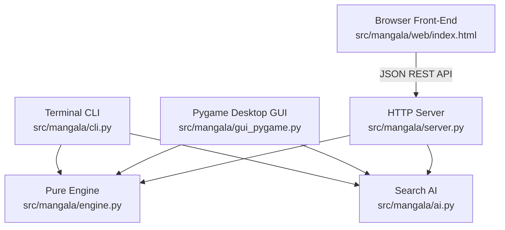

# Turkish Mangala — Software Architecture & Design

This document details the architectural principles, component structure, search algorithms, and security model of the `mangala` codebase.

---

## 1. System Overview



### Key Principles
1. **Zero External Runtime Dependencies**: The core game engine, AI search, HTTP backend, and terminal CLI run exclusively on the Python standard library.
2. **Pure, Immutable Domain Logic**: `engine.py` contains no I/O, no UI rendering, and no mutable side-effects. Game states are frozen dataclasses.
3. **Thread-Safe AI Search**: Each search execution encapsulates its transposition table, time deadlines, and node statistics within an independent `Searcher` instance.
4. **Security Hardening**: The HTTP server enforces strict body size caps, parameter clamping, path traversal boundaries, and security headers.

---

## 2. Core Engine (`src/mangala/engine.py`)

### `GameState` Representation
```python
@dataclass(frozen=True)
class GameState:
    pits: list[int]               # Length 14 (pits 0-5, 6: P1 treas, 7-12, 13: P2 treas)
    current_player: int           # 0 (Player 1) or 1 (Player 2)
    game_over: bool = False
    winner: Optional[int] = None  # 0, 1, or -1 (tie)
```

- **Immutability**: `apply_move(state, pit)` produces a new `GameState` copy without mutating the input, allowing the AI to branch freely across game trees.
- **Invariants**:
  - $\sum_{i=0}^{13} \text{pits}[i] = 48$ is strictly preserved at every step.
  - $\text{pits}[i] \ge 0$ for all $i \in [0, 13]$.

---

## 3. AI Search Engine (`src/mangala/ai.py`)

Mangala's state space features extra-turn branches and non-linear captures. Standard negamax architectures struggle with extra turns (where the same player moves again without a sign flip). Our engine uses an **explicit root-perspective Minimax** with Alpha-Beta pruning:

### 1. Symmetrical Minimax with Extra Turns
At each search node:
- If `state.current_player == root`: The node is a **Maximizer**.
- If `state.current_player != root`: The node is a **Minimizer**.
When a move triggers an extra turn (`events['extra_turn'] == True`), `next_state.current_player` remains unchanged, and the search recurses naturally without sign alternation.

### 2. Transposition Table (TT)
Positions are keyed by `(tuple(state.pits), state.current_player)`:
- Entries store: `(depth, eval_value, flag, best_move)`
- Flags:
  - `_EXACT`: Exact minimax evaluation.
  - `_LOWER_BOUND`: Fail-high cut (beta cutoff).
  - `_UPPER_BOUND`: Fail-low (alpha cutoff).
- **PV-First Ordering**: If a TT hit exists, the stored `best_move` is tried first at subsequent depths, yielding optimal $\alpha$-$\beta$ move pruning.

### 3. Iterative Deepening & Time Budget
The `Searcher` iterates depths $d = 1, 2, 3, \dots, 64$:
- Uses a clock check mask (`nodes & 0x3FF == 0`) to check time deadlines once every 1024 nodes, minimizing clock syscall overhead.
- When `_TimeUp` is raised, the search safely catches the exception and returns the best move from the last **fully completed** depth iteration.
- If a terminal score ($\ge \pm 10,000$) or full game solve is detected, the search exits early.

### 4. Quiescence Search
At depth-0 leaf nodes, tactical sequences (captures and extra turns) are extended up to `_Q_DEPTH = 4` plies:
- Utilizes "stand-pat" lower/upper bounds so the player can choose to make no noisy moves if standing pat is superior.
- Completely neutralizes the classic "horizon effect" where blunders hide right behind the search boundary.

### 5. Heuristic Evaluation
$$E(s) = \Delta T + 0.1 \cdot \Delta M + B_{\text{tempo}} + O_{\text{empty}} - P_{\text{capture}} - P_{\text{empty}}$$

- **$\Delta T$ (Treasury Advantage)**: Score difference between root and opponent.
- **$\Delta M$ (Mobility)**: Total active stones on root's side vs opponent's side.
- **$B_{\text{tempo}}$ (Tempo Potential)**: $+0.4$ bonus for each owned pit whose last stone lands in the root treasury.
- **$O_{\text{empty}}$ (Empty-Hole Offense)**: $+0.25 \cdot (\text{opp\_stones} + 1)$ for landing in an owned empty hole facing opponent stones.
- **$P_{\text{capture}}$ (Exposure Penalty)**: $-0.3$ penalty for owned even-count pits vulnerable to immediate capture.
- **$P_{\text{empty}}$ (Empty-Hole Vulnerability)**: $-0.25 \cdot (\text{opp\_stones} + 1)$ for empty owned pits threatened by opponent distribution paths.

### 6. Endgame Exact Solver
When remaining stones on the board satisfy $\sum \le 12$, search depth is automatically elevated to $64$. The reduced branching factor collapses the search tree into negligible millisecond solves.

---

## 4. Web Server & API (`src/mangala/server.py`)

- **Concurrency**: Backed by `ThreadingHTTPServer`. A bounded semaphore (`_search_slots = 4`) prevents CPU starvation by limiting concurrent heavy searches.
- **Request Validation**:
  - `dict_to_state()` rigorously parses JSON inputs, ensuring length 14, non-negative integers, stone conservation, and valid player indices.
  - Rejects oversized payloads ($> 4096$ bytes) with HTTP 400.
  - Clamps `time_limit` to $[0.05, 5.0]$ seconds.
- **Security Headers**:
  - `X-Content-Type-Options: nosniff`
  - `X-Frame-Options: DENY`
  - Strict `Content-Security-Policy` restricting script and style origins to `'self' 'unsafe-inline'`.
  - Canonical path resolution via `os.path.commonpath` to eliminate path traversal risks.
